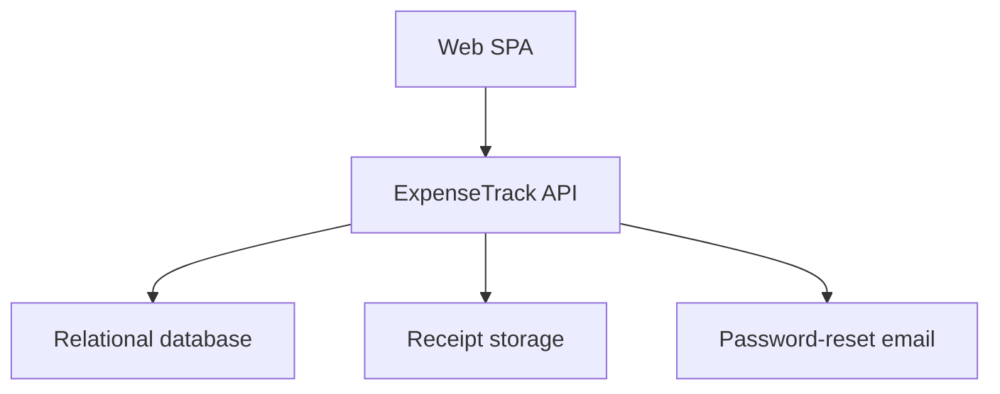
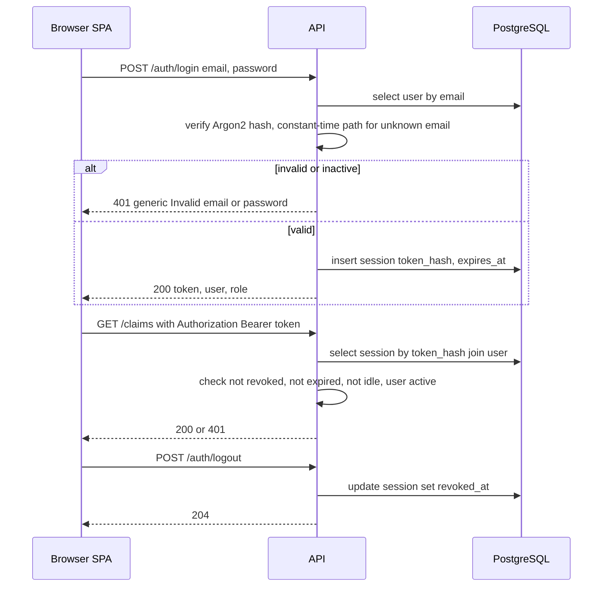
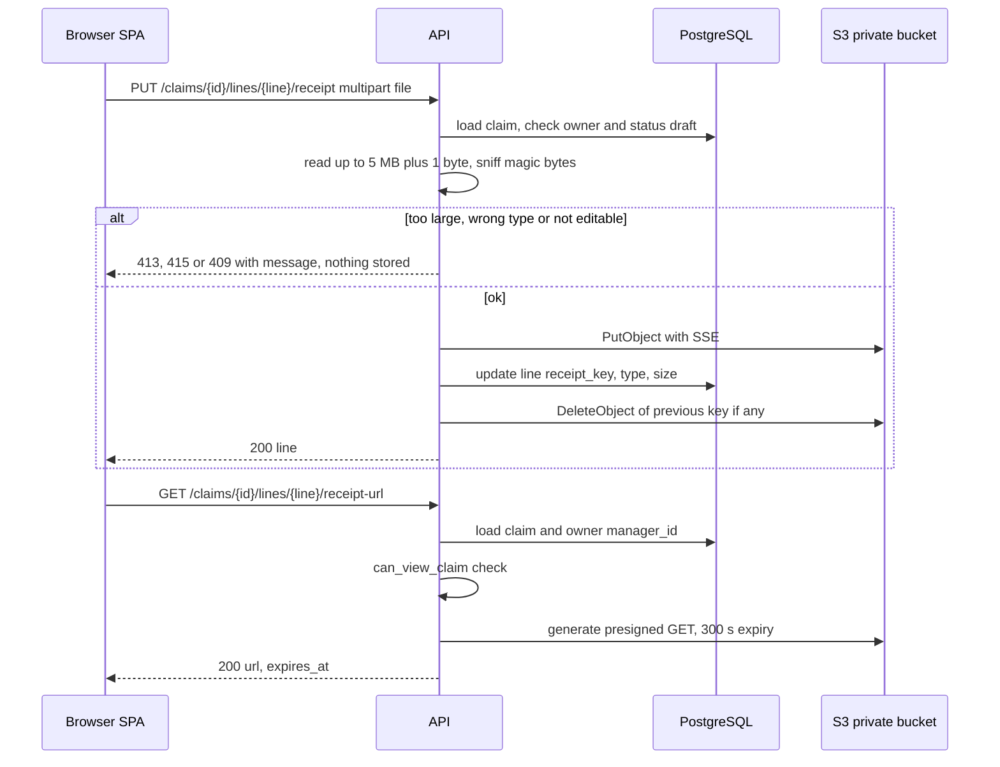
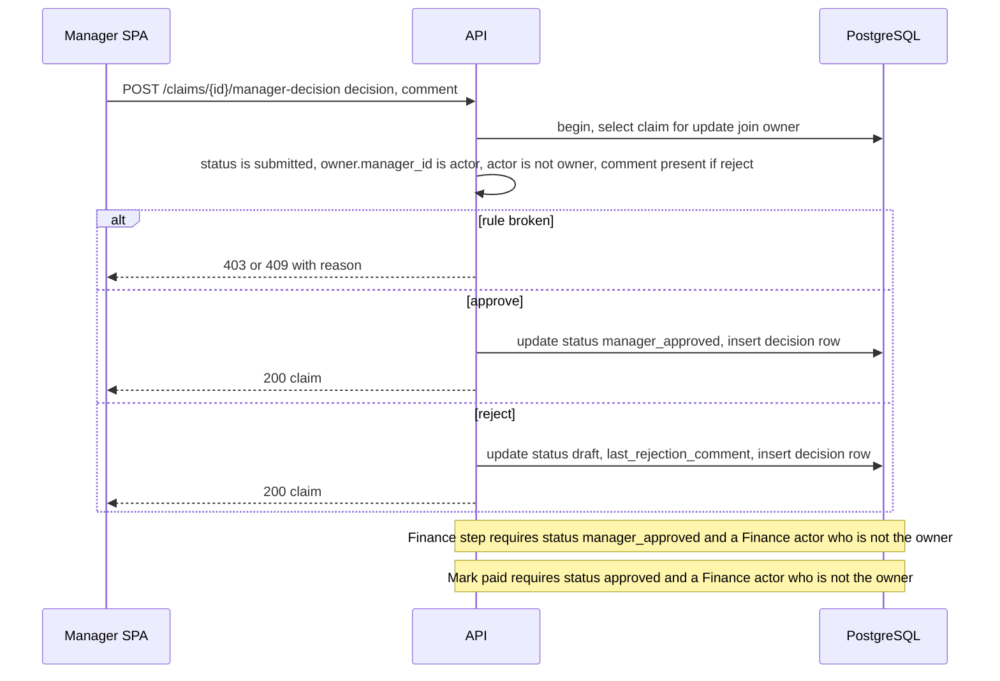
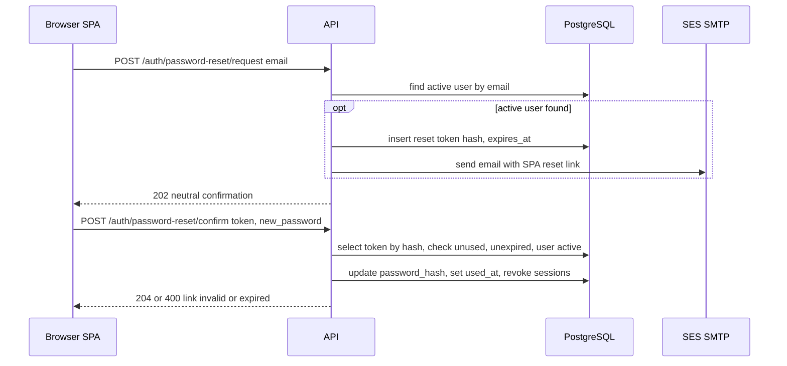
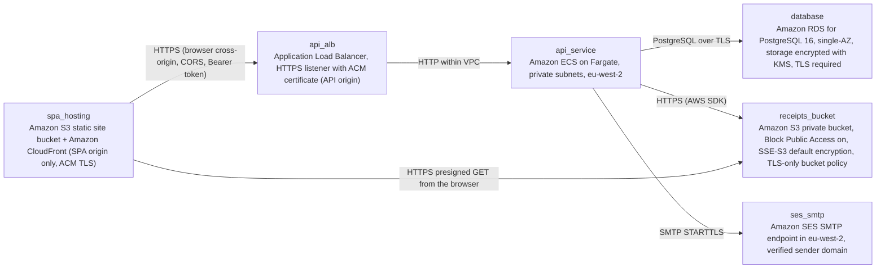

# Architecture

> Maintained by QuorQ AI SDLC. Text between `sdlc:auto` markers is regenerated; anything outside them is yours and is kept.

<!-- sdlc:auto:start narrative -->
## Overview

### ARCH-OVERVIEW · approved · source: architecture:v1

ExpenseTrack handles employee expense claims for a company of up to 50 people. A React 19 SPA calls a FastAPI 0.115 API, backed by PostgreSQL 16 and a private S3 bucket for receipts. The architecture is approved at version 1 and runs in a single AWS region (London, eu-west-2).

Status: approved, version 1.

Shape:
- React 19 SPA on its own HTTPS origin.
- FastAPI 0.115 API on a separate HTTPS origin.
- PostgreSQL 16 for data.
- Private, encrypted Amazon S3 bucket for receipts.
- Amazon SES over SMTP for password-reset email only.

The API holds all business rules:
- Role-based visibility.
- Claim state machine: Draft -> Submitted -> Manager approved -> Approved -> Paid.
- No self-approval.
- Locking of submitted claims.
- Over-limit flags.
- Finance totals and CSV export.

Data:
- GBP amounts stored as exact NUMERIC(12,2).
- Append-only decision history.

Security:
- Receipts are checked by content and size in the API.
- Receipts are viewed only through short-lived presigned links, issued after an authorisation check.
- Server-side sessions use an opaque bearer token.
- Sign-out, expiry and deactivation revoke the token on the server.

Region: single AWS region, London (eu-west-2). Stated rationale: keep personal data in the UK and meet basic UK GDPR expectations.

Context from the project description:
- Roles: Employee, Manager, Finance.
- No self sign-up. Finance creates accounts and assigns each employee a manager.
- English only.
- Out of scope: currency conversion, mileage, card feeds, accounting integrations.

**Related:** ARCH-COMP-WEB, ARCH-COMP-API, ARCH-COMP-DB, ARCH-COMP-RECEIPTS, ARCH-COMP-EMAIL, ARCH-DEPLOY

### ARCH-COMP-WEB · approved · source: architecture:component:web

Role-aware React 19 single-page app that serves Employee, Manager and Finance screens from one bundle. It holds the session token in sessionStorage and calls the API with a bearer header. All real enforcement stays on the API.

Screens covered:
- Sign-in and password reset pages.
- My claims.
- Claim editor with receipt upload.
- Claim detail with history and over-limit flags.
- Approval queues.
- Finance admin screens (users and categories).
- Dashboards and CSV download.

Session handling:
- The opaque session token is stored in sessionStorage.
- It is sent as `Authorization: Bearer` on every call.

Configuration: the API base URL is read from VITE_API_BASE_URL, which is set at build time.

**Related:** ARCH-OVERVIEW, ARCH-COMP-API, ADR-FRONTEND, ARCH-PATH-AUTH

### ARCH-COMP-API · approved · source: architecture:component:api

FastAPI 0.115 REST API that holds every business rule. It also includes a CLI to create the first Finance user.

Responsibilities:
- Authentication and session validation.
- User administration.
- Category management.
- Claims and claim lines.
- Receipt validation and storage.
- Approval and payment state machine.
- Visibility scoping.
- Dashboards.
- CSV export.
- CLI to create the first Finance user. This bootstraps the system, since there is no self sign-up.

**Related:** ARCH-OVERVIEW, ADR-BACKEND, ARCH-API-AUTH, ARCH-API-USERS, ARCH-API-CATEGORIES, ARCH-API-CLAIMS, ARCH-API-APPROVALS, ARCH-API-REPORTS

### ARCH-COMP-DB · approved · source: architecture:component:db

PostgreSQL 16 stores users, sessions, reset tokens, categories, claims, lines and the append-only decision history. It provides transactional status changes and exact GBP arithmetic, and is encrypted at rest.

- Tables: users, sessions, password_reset_tokens, categories, claims, claim_lines, claim_decisions.
- Status changes are transactional.
- GBP arithmetic is exact (NUMERIC).
- Encrypted at rest.

**Related:** ADR-DATABASE, ARCH-DATA-MODEL

### ARCH-COMP-RECEIPTS · approved · source: architecture:component:receipt_store

Private Amazon S3 bucket that holds receipt files. Block Public Access and SSE encryption are on. Files are reachable only through presigned GET URLs that expire after 5 minutes.

- Private bucket with Block Public Access enabled.
- SSE encryption (SSE-S3 per the deployment node).
- Access only via presigned GET URLs that expire after 5 minutes (300 seconds).

**Related:** ADR-FILE-STORAGE, ARCH-PATH-RECEIPT

### ARCH-COMP-EMAIL · approved · source: architecture:component:email

Amazon SES, used through its SMTP interface, sends password-reset emails only, from a verified domain.

- Single purpose: password-reset email. This is the only email the system sends.
- Sent from the verified domain.
- Uses the Amazon SES SMTP endpoint in eu-west-2.

**Related:** ADR-EMAIL, ARCH-PATH-RESET

### ARCH-PATH-AUTH · approved · source: architecture:critical_path:sign-in-session-signout-deactivation

Login uses Argon2 password verification and server-side sessions. Only a SHA-256 hash of a random opaque token is stored. Sessions have an absolute lifetime and an idle timeout, and are revoked on sign-out or user deactivation.

Login:
- Checks the email and the Argon2 password hash.
- Creates a session row storing the SHA-256 hash of a random opaque token.
- Returns the token once, in the response body.
- A wrong email or a wrong password returns the same generic 401.

On every request:
- The bearer token must resolve to an active session and an active user.
- Absolute lifetime: SESSION_ABSOLUTE_HOURS, default 12.
- Idle timeout: SESSION_IDLE_MINUTES, default 60.

Sign-out: sets revoked_at on the session.

Deactivation:
- Revokes all of the user's sessions in the same transaction.
- The user's next request returns 401.

**Related:** ARCH-API-AUTH, ARCH-API-USERS, ARCH-COMP-WEB

### ARCH-PATH-RECEIPT · approved · source: architecture:critical_path:receipt-upload-viewing

Receipts are uploaded through the API so that size, content type and ownership checks run before anything is stored. Viewing requires a visibility check, then returns a presigned link valid for 300 seconds.

Upload:
1. The API rejects bodies over 5 MB using a bounded read.
2. It detects the file type from magic bytes. Only JPEG, PNG or PDF are allowed.
3. It confirms the claim is a draft owned by the caller.
4. It puts the object to the private bucket with SSE, under the key `receipts/{claim_id}/{line_id}/{uuid}`.
5. It updates the line's receipt metadata.
6. It deletes the replaced object, if any.

Viewing:
- can_view_claim must pass. Allowed viewers are the owner, the owner's current manager, or Finance.
- Only then does the API issue a presigned GET URL, which expires after 300 seconds.

**Related:** ARCH-COMP-RECEIPTS, ARCH-API-CLAIMS

### ARCH-PATH-WORKFLOW · approved · source: architecture:critical_path:claim-workflow

Each claim transition (submit, manager decision, Finance decision, mark paid) runs in one transaction with a row lock, a status check and actor-rule checks. Each one appends a decision record. A rejection at either step returns the claim to draft with a stored comment.

Every transition, in one transaction:
1. Locks the claim row with SELECT FOR UPDATE.
2. Checks the expected current status and the actor rules.
3. Updates the status.
4. Appends a claim_decisions row with a snapshot of the actor's name.

Actor rules:
- Manager step: claim.owner.manager_id must equal the actor, and the actor must not be the owner.
- Finance step: the actor must be a Finance user who is not the owner.
- Mark paid: the actor must be a Finance user who is not the owner, and the status must be Approved.

Rejection:
- At either step, rejection sets the status back to draft and stores last_rejection_comment.
- A comment is required to reject.
- Resubmission starts again at step 1.

Over-limit flags:
- Computed at read time from the current category limit, not stored.

Discrepancy to confirm:
- Project description: a manager approves or rejects "with a comment".
- Architecture: a comment is required only to reject.
- Both versions are recorded here.

**Related:** ARCH-API-APPROVALS, ARCH-API-CLAIMS, ARCH-DATA-MODEL

### ARCH-PATH-RESET · approved · source: architecture:critical_path:password-reset

Password reset returns the same neutral response whatever the email, and emails a single-use token only to active users. The token expires after 60 minutes. Confirming a reset revokes all of the user's existing sessions.

Request:
- Always returns the same 202 message.
- A token is created and an email sent only if the email belongs to an active user.
- The token is random, stored as a SHA-256 hash, expires after 60 minutes, and is single use.

Confirm:
- Checks that the token is unused, unexpired and belongs to an active user.
- Sets the new password hash.
- Marks the token used.
- Revokes all of the user's existing sessions.

**Related:** ARCH-API-AUTH, ARCH-COMP-EMAIL, ARCH-PATH-AUTH

### ARCH-DATA-MODEL · approved · source: architecture:entities

Seven entities: users, sessions, password_reset_tokens, categories, claims, claim_lines and claim_decisions (the append-only decision history).

- users: id, email, full_name, role, manager_id, password_hash, is_active, deactivated_at, created_at, updated_at
- sessions: id, user_id, token_hash, created_at, last_seen_at, expires_at, revoked_at
- password_reset_tokens: id, user_id, token_hash, expires_at, used_at, created_at
- categories: id, name, per_line_limit, is_active, created_at
- claims: id, owner_id, title, status, total_amount, last_rejection_comment, submitted_at, paid_at, paid_by_id, created_at, updated_at
- claim_lines: id, claim_id, line_date, category_id, amount, description, receipt_key, receipt_content_type, receipt_size_bytes, receipt_filename, position
- claim_decisions: id, claim_id, step, decision, actor_id, actor_name, comment, created_at. Append-only; actor_name is a snapshot.

Note: the project description lists the categories Travel, Meals, Equipment and Other. The architecture input does not say how these are seeded.

**Related:** ARCH-COMP-DB, ADR-DATABASE

### ARCH-API-AUTH · approved · source: architecture:endpoints:/auth

Authentication endpoints: login, logout, current user, and the two-step password reset.

- POST /auth/login: sign in. Returns a generic 401 on any failure.
- POST /auth/logout: revokes the current session.
- GET /auth/me: returns the current user and role. The SPA uses it to choose which screens to show.
- POST /auth/password-reset/request: requests a reset email. Always returns the same neutral response.
- POST /auth/password-reset/confirm: sets a new password using a single-use token.

**Related:** ARCH-PATH-AUTH, ARCH-PATH-RESET

### ARCH-API-USERS · approved · source: architecture:endpoints:/users

User administration endpoints: list, create, edit role or manager, deactivate and reactivate. Manager assignment is validated against self-management and cycles.

- GET /users: lists users with role, manager and active state. Supports an ?active filter.
- POST /users: creates a user with an initial password.
  - 409 if the email is already in use.
  - 422 if the user is set as their own manager.
- PATCH /users/{id}: changes name, role or assigned manager. Self-management and manager cycles are rejected.
- POST /users/{id}/deactivate: deactivates the user and revokes all of their sessions.
- POST /users/{id}/reactivate: reactivates the user.

**Related:** ARCH-PATH-AUTH, ARCH-COMP-API

### ARCH-API-CATEGORIES · approved · source: architecture:endpoints:/categories

Category endpoints: list, add, and edit. Edits cover renaming, setting or clearing the per-line limit, and deactivating or reactivating.

- GET /categories: active categories only, unless include_inactive is set (Finance).
- POST /categories: adds a category with an optional per-line limit.
- PATCH /categories/{id}: rename, set or clear the limit, or deactivate or reactivate.

**Related:** ARCH-PATH-WORKFLOW, ARCH-DATA-MODEL

### ARCH-API-CLAIMS · approved · source: architecture:endpoints:/claims

Claim, line and receipt endpoints. Drafts are editable only by their owner. Line amounts must be positive with at most 2 decimal places. Submitting locks the claim and routes it to the owner's manager.

Claims:
- GET /claims: lists visible claims. scope=mine|team|all, limited by role.
- POST /claims: creates a draft claim, optionally with lines.
- GET /claims/{id}: claim detail. Returns 404 if the claim is not visible to the caller. Includes:
  - lines
  - over-limit flags with the limit
  - receipt presence
  - decision history
  - last rejection comment
- PATCH /claims/{id}: updates the title of a draft owned by the caller.
- DELETE /claims/{id}: deletes the caller's own draft and its receipts.
- POST /claims/{id}/submit: submits a draft with at least one line. This locks the claim and routes it to the owner's assigned manager.

Lines:
- POST /claims/{id}/lines: adds a line and recalculates the total.
  - Amount must be > 0 with at most 2 decimal places.
  - The category must be active.
- PATCH /claims/{id}/lines/{line_id}: edits a line and recalculates the total.
- DELETE /claims/{id}/lines/{line_id}: removes a line and its receipt, then recalculates the total.

Receipts:
- PUT /claims/{id}/lines/{line_id}/receipt: attaches or replaces a receipt. The type is checked by content, and the file must be 5 MB or less.
- DELETE /claims/{id}/lines/{line_id}/receipt: removes a receipt.
- GET /claims/{id}/lines/{line_id}/receipt-url: issues a presigned GET link that expires after 300 seconds.

**Related:** ARCH-PATH-WORKFLOW, ARCH-PATH-RECEIPT, ARCH-DATA-MODEL

### ARCH-API-APPROVALS · approved · source: architecture:endpoints:/approvals,/claims/{id}/decisions

Approval endpoints: role-scoped approval queues, the manager decision (step 1), the Finance decision (step 2), and mark paid. Nobody can act on their own claim.

- GET /approvals/queue:
  - Manager: Submitted claims of direct reports, excluding their own.
  - Finance: Manager approved and Approved claims, excluding their own.
- POST /claims/{id}/manager-decision: step 1 approve or reject.
  - The caller must be the owner's current manager and not the owner.
  - Reject requires a comment.
- POST /claims/{id}/finance-decision: step 2 approve or reject.
  - The claim must be Manager approved.
  - The caller must be a Finance user who is not the owner.
- POST /claims/{id}/mark-paid: changes Approved to Paid and records the date and the actor.
  - The caller must be a Finance user who is not the owner.
  - This is a status change only. No money moves.

**Related:** ARCH-PATH-WORKFLOW

### ARCH-API-REPORTS · approved · source: architecture:endpoints:/dashboard,/reports,/health

Endpoints for the employee dashboard, Finance totals by category and month, the CSV export of Finance-approved lines, and a health check.

- GET /dashboard/me: count and GBP total per status for the caller's own claims.
- GET /reports/finance-totals: GBP totals by category and by month of line date, for Approved and Paid claims only.
- GET /reports/approved-claims.csv: one row per line for Finance-approved claims (Approved or Paid) whose line_date is in the requested range. Returns headers only if nothing matches.
- GET /health: liveness check for the load balancer.

Scope refinement to confirm:
- Project description: Finance can "export approved claims as CSV".
- Architecture: the export includes claims in Approved or Paid status, filtered by line_date range.
- Both versions are recorded here.

**Related:** ARCH-COMP-WEB, ARCH-DEPLOY

### ARCH-DEPLOY · approved · source: architecture:deployment_nodes

Six AWS deployment nodes in eu-west-2:
- CloudFront and S3 for the SPA.
- An ALB in front of ECS Fargate for the API.
- Single-AZ encrypted RDS PostgreSQL 16.
- A private encrypted receipts bucket.
- The SES SMTP endpoint.

- spa_hosting: S3 static site bucket plus CloudFront (SPA origin only, ACM TLS). Serves the static React 19 build, with VITE_API_BASE_URL set at build.
- api_alb: Application Load Balancer with an HTTPS listener on 443 and an ACM certificate for the API origin. HTTP redirects to HTTPS.
- api_service: Amazon ECS on Fargate, in private subnets in eu-west-2. Runs the FastAPI 0.115 container under uvicorn. Environment and secrets come from SSM Parameter Store.
- database: Amazon RDS for PostgreSQL 16, single-AZ. Storage is encrypted with KMS, and TLS is required.
- receipts_bucket: private S3 bucket. Block Public Access on, SSE-S3 default encryption, and a TLS-only bucket policy.
- ses_smtp: Amazon SES SMTP endpoint in eu-west-2 with a verified sender domain. SMTP with STARTTLS on port 587.

**Related:** ADR-CLOUD, ARCH-COMP-WEB, ARCH-COMP-API, ARCH-COMP-DB, ARCH-COMP-RECEIPTS, ARCH-COMP-EMAIL

### ADR-FRONTEND · approved · source: architecture:technology_decisions:frontend

Frontend: React 19, chosen over Vue and Angular. It is the approved stack, built as a TypeScript SPA with Vite.

- Decision: React 19.
- Alternatives considered: Vue, Angular.
- Rationale: approved stack.
- Build and deploy: TypeScript SPA built with Vite, deployed as static files to its own origin.
- Role-aware routing shows Employee, Manager and Finance screens from one bundle. All real enforcement stays on the API.

**Related:** ARCH-COMP-WEB

### ADR-BACKEND · approved · source: architecture:technology_decisions:backend

Backend: FastAPI 0.115, chosen over Django and NestJS. A single API holds all rules, and Pydantic gives the field-level validation messages required by AC-031 and NFR-014.

- Decision: FastAPI 0.115.
- Alternatives considered: Django, NestJS.
- Rationale: approved stack. A single API holds:
  - the workflow state machine
  - the visibility policy
  - opaque-token sessions
  - receipt checks
  - presigned links
  - CSV streaming
- Pydantic models provide the field-level validation messages required by AC-031 and NFR-014.

**Related:** ARCH-COMP-API, AC-031, NFR-014

### ADR-DATABASE · approved · source: architecture:technology_decisions:database

Database: PostgreSQL 16, chosen over MySQL. It gives exact GBP amounts, safe status transitions through row locks, and simple dashboard queries, with no separate session store needed.

- Decision: PostgreSQL 16.
- Alternative considered: MySQL.
- Rationale:
  - approved stack
  - NUMERIC(12,2) keeps GBP exact
  - row locks make status transitions safe
  - plain GROUP BY queries produce the dashboards
- Sessions and reset tokens also live in PostgreSQL, so no separate cache or session store is needed.

**Related:** ARCH-COMP-DB, ARCH-DATA-MODEL

### ADR-CLOUD · approved · source: architecture:technology_decisions:cloud

Cloud: AWS, chosen over Azure and GCP. Everything runs in eu-west-2 London.

- Decision: AWS.
- Alternatives considered: Azure, GCP.
- Rationale: approved stack.
- Region: eu-west-2 London for all services:
  - S3 and CloudFront for the SPA
  - ALB and ECS Fargate for the API
  - RDS for PostgreSQL 16
  - a private encrypted S3 bucket for receipts
  - SES for reset email
- The overview gives the single-region rationale: keep personal data in the UK and meet basic UK GDPR expectations.

**Related:** ARCH-DEPLOY

### ADR-FILE-STORAGE · approved · source: architecture:technology_decisions:file_storage

Receipt storage: Amazon S3, chosen over storing receipts as PostgreSQL bytea, because only S3 can natively issue the short-lived, expiring links the requirements ask for.

- Decision: Amazon S3.
- Alternative considered: storing receipts as PostgreSQL bytea.
- Rationale:
  - PostgreSQL could hold the files but cannot issue short-lived, expiring links.
  - S3 presigned URLs do this natively with a private bucket.

**Related:** ARCH-COMP-RECEIPTS, ARCH-PATH-RECEIPT

### ADR-EMAIL · approved · source: architecture:technology_decisions:email

Email: Amazon SES through its SMTP interface, chosen over SendGrid. It is used for password-reset emails only, sent with Python's standard smtplib.

- Decision: SMTP server service, using Amazon SES's SMTP interface.
- Alternative considered: SendGrid.
- Scope: password-reset emails only.
- Rationale: Python's standard smtplib is sufficient, so no extra library is needed.

**Related:** ARCH-COMP-EMAIL, ARCH-PATH-RESET
<!-- sdlc:auto:end narrative -->

<!-- sdlc:auto:start building-blocks -->
## Building Block View

| ID | Name | Technology | Responsibility | Depends on |
|---|---|---|---|---|
| web | Web SPA | React 19 | Role-aware UI covering the sign-in and reset pages, My claims, claim editor with receipt upload, claim detail with history and over-limit flags, approval queues, the Finance admin screens (users and categories), dashboards and CSV download. It stores the opaque session token in sessionStorage, sends it as Authorization: Bearer on every call, and reads the API base URL from VITE_API_BASE_URL. | api |
| api | ExpenseTrack API | FastAPI 0.115 | REST API holding all rules. It covers authentication and session validation, user administration, category management, claims and lines, receipt validation and storage, the approval and payment state machine, visibility scoping, dashboards, CSV export, and a CLI to create the first Finance user. | db, receipt_store, email |
| db | Relational database | PostgreSQL 16 | Stores users, sessions, reset tokens, categories, claims, lines and the append-only decision history. It provides transactional status changes and exact NUMERIC GBP arithmetic, and stays encrypted at rest. | — |
| receipt_store | Receipt storage | Amazon S3 on AWS | Private bucket with Block Public Access and SSE encryption that holds the receipt files. Files are reachable only via presigned GET URLs that expire after 5 minutes. | — |
| email | Password-reset email | Amazon SES via SMTP (approved SMTP server service) on AWS | Sends password-reset emails only, from the verified domain. | — |

<!-- sdlc:auto:end building-blocks -->

<!-- sdlc:auto:start runtime -->
## Runtime View

### Sign-in, session validation, sign-out and deactivation

Login checks the email and Argon2 hash, then creates a session row holding the SHA-256 hash of a random opaque token. The token is returned once in the response body. Each request resolves the bearer token to an active session and an active user, and enforces an absolute lifetime (SESSION_ABSOLUTE_HOURS, default 12) and an idle timeout (SESSION_IDLE_MINUTES, default 60). Sign-out sets revoked_at. Deactivation revokes all of the user's sessions in the same transaction, and the next request returns 401. A wrong email or wrong password returns the same generic 401.

- **Components:** web, api, db
- **Modules:** app/auth/router.py, app/auth/service.py, app/auth/deps.py, app/auth/passwords.py
- **Key functions:** login(email, password) -> LoginResponse, hash_password(plain) -> str, verify_password(hash, plain) -> bool, create_session(user_id) -> token, get_current_user(authorization_header) -> User, logout(session), revoke_user_sessions(user_id)

### Receipt upload and short-lived viewing

The upload goes through the API so that checks run before anything is stored. The API rejects bodies over 5 MB with a bounded read, detects the type from the file's magic bytes (JPEG, PNG or PDF only), and confirms the claim is a draft owned by the caller. It then puts the object to the private bucket with SSE under the key receipts/{claim_id}/{line_id}/{uuid}, updates the line, and deletes the replaced object. Viewing calls can_view_claim (owner, owner's current manager, or Finance) and only then issues a presigned GET URL that expires after 300 seconds.

- **Components:** web, api, receipt_store, db
- **Modules:** app/receipts/router.py, app/receipts/service.py, app/storage/s3.py, app/claims/policy.py
- **Key functions:** upload_receipt(claim_id, line_id, file, user), sniff_type(head_bytes) -> mime\|None, put_object(key, body, content_type), delete_object(key), get_receipt_url(claim_id, line_id, user) -> url, can_view_claim(user, claim) -> bool, assert_editable_draft(user, claim)

### Claim workflow: submit, manager decision, finance decision, mark paid

Each transition runs in one transaction. It locks the claim row with SELECT FOR UPDATE, checks the expected current status and the actor rules, updates the status, and appends a claim_decisions row with a snapshot of the actor's name. The actor rules are: the manager step requires claim.owner.manager_id equal to the actor and the actor not being the owner. The Finance step requires a Finance actor who is not the owner. Mark paid requires a Finance actor who is not the owner and status Approved. Rejection at either step sets status back to draft and stores last_rejection_comment. A comment is required to reject, and resubmission starts again at step 1. Over-limit flags are computed at read time from the current category limit.

- **Components:** api, db, web
- **Modules:** app/workflow/router.py, app/workflow/service.py, app/claims/policy.py, app/claims/queries.py
- **Key functions:** submit_claim(claim_id, user), manager_decide(claim_id, user, decision, comment), finance_decide(claim_id, user, decision, comment), mark_paid(claim_id, user), transition(claim, from_status, to_status, actor, step, comment), approval_queue(user) -> list[ClaimSummary], line_over_limit(line, category) -> bool

### Password reset by email

A reset request always returns the same 202 message. A token is created and an email sent only if the email belongs to an active user. The token is random and stored as a SHA-256 hash with a 60-minute expiry, and is single use. Confirming checks that the token is unused, unexpired and belongs to an active user. It then sets the new hash, marks the token used, and revokes all of the user's existing sessions.

- **Components:** web, api, db, email
- **Modules:** app/auth/reset.py, app/notify/smtp_mailer.py
- **Key functions:** request_reset(email), create_reset_token(user_id) -> token, send_reset_email(to, link), confirm_reset(token, new_password)

<!-- sdlc:auto:end runtime -->

<!-- sdlc:auto:start deployment-view -->
## Deployment View

| Name | Service | Runtime | Scaling | Environment |
|---|---|---|---|---|
| spa_hosting | Amazon S3 static site bucket + Amazon CloudFront (SPA origin only, ACM TLS) | Static React 19 build, VITE_API_BASE_URL set at build | Managed CDN | dev |
| api_alb | Application Load Balancer, HTTPS listener with ACM certificate (API origin) | HTTPS 443, HTTP redirects to HTTPS | Managed | dev |
| api_service | Amazon ECS on Fargate, private subnets, eu-west-2 | FastAPI 0.115 container under uvicorn. Env and secrets come from SSM Parameter Store. | 1 task (max 2), no autoscaling needed for 50 users | dev |
| database | Amazon RDS for PostgreSQL 16, single-AZ, storage encrypted with KMS, TLS required | PostgreSQL 16 | Small burstable instance, automated backups | dev |
| receipts_bucket | Amazon S3 private bucket, Block Public Access on, SSE-S3 default encryption, TLS-only bucket policy | Object storage | Managed | dev |
| ses_smtp | Amazon SES SMTP endpoint in eu-west-2, verified sender domain | SMTP with STARTTLS on port 587 | Managed | dev |

| Source | Target | Protocol |
|---|---|---|
| spa_hosting | api_alb | HTTPS (browser cross-origin, CORS, Bearer token) |
| api_alb | api_service | HTTP within VPC |
| api_service | database | PostgreSQL over TLS |
| api_service | receipts_bucket | HTTPS (AWS SDK) |
| spa_hosting | receipts_bucket | HTTPS presigned GET from the browser |
| api_service | ses_smtp | SMTP STARTTLS |

<!-- sdlc:auto:end deployment-view -->

<!-- sdlc:auto:start decisions -->
## Architecture Decisions

| Layer | Choice | ADR |
|---|---|---|
| Frontend | React 19 | [ADR-0001](adr/frontend.md) |
| Backend | FastAPI 0.115 | [ADR-0002](adr/backend.md) |
| Database | PostgreSQL 16 | [ADR-0003](adr/database.md) |
| Cloud | AWS | [ADR-0004](adr/cloud.md) |
| File storage | Amazon S3 | [ADR-0005](adr/file-storage.md) |
| Email | SMTP server | [ADR-0006](adr/email.md) |
<!-- sdlc:auto:end decisions -->

<!-- sdlc:auto:start links -->
## Related Documents

- [Data Model](data-model.md)
- [API Specification](api/openapi.yaml)
- [Architecture Decision Records](adr/README.md)
<!-- sdlc:auto:end links -->
