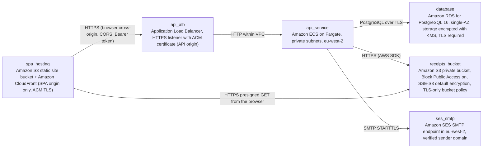

# Deployment Guide

> Maintained by QuorQ AI SDLC. Text between `sdlc:auto` markers is regenerated; anything outside them is yours and is kept.

<!-- sdlc:auto:start how-it-deploys -->
Pushes to `main` run `.github/workflows/deploy.yml`, which builds the API image (if there is a backend) and deploys the SPA to AWS Amplify. Commits touching only `docs/sdlc/**` don't deploy. Deployments can also be started from the platform's Deployment tab.
<!-- sdlc:auto:end how-it-deploys -->

<!-- sdlc:auto:start environments -->
| Name | Service | Runtime | Scaling | Environment |
|---|---|---|---|---|
| spa_hosting | Amazon S3 static site bucket + Amazon CloudFront (SPA origin only, ACM TLS) | Static React 19 build, VITE_API_BASE_URL set at build | Managed CDN | dev |
| api_alb | Application Load Balancer, HTTPS listener with ACM certificate (API origin) | HTTPS 443, HTTP redirects to HTTPS | Managed | dev |
| api_service | Amazon ECS on Fargate, private subnets, eu-west-2 | FastAPI 0.115 container under uvicorn. Env and secrets come from SSM Parameter Store. | 1 task (max 2), no autoscaling needed for 50 users | dev |
| database | Amazon RDS for PostgreSQL 16, single-AZ, storage encrypted with KMS, TLS required | PostgreSQL 16 | Small burstable instance, automated backups | dev |
| receipts_bucket | Amazon S3 private bucket, Block Public Access on, SSE-S3 default encryption, TLS-only bucket policy | Object storage | Managed | dev |
| ses_smtp | Amazon SES SMTP endpoint in eu-west-2, verified sender domain | SMTP with STARTTLS on port 587 | Managed | dev |
<!-- sdlc:auto:end environments -->

<!-- sdlc:auto:start live -->
_Not deployed yet._
<!-- sdlc:auto:end live -->

<!-- sdlc:auto:start topology -->

<!-- sdlc:auto:end topology -->
